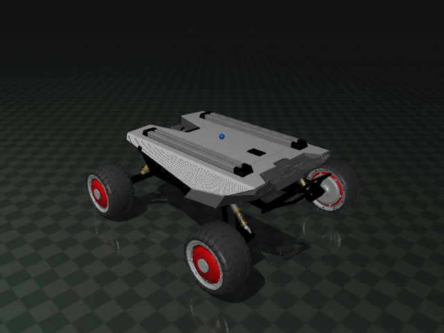

# OU-AVG — SCOUT MINI MuJoCo Simulation

A MuJoCo simulation of the AgileX SCOUT MINI four-wheel differential-drive robot,
with converted Gazebo meshes and a Python launcher for Windows, macOS, and Linux.
The model includes four driven wheels, ground contact, wheel-speed sensors, an
IMU, and a tracking camera. ROS and Gazebo are not required to run it.



## Setup

Use Python 3.9 or newer. Clone the repository and open its directory:

```bash
git clone https://github.com/dmarslab/OU-AVG.git
cd OU-AVG
```

Create and activate a virtual environment on **macOS / Linux**:

```bash
python3 -m venv .venv
source .venv/bin/activate
```

Or on **Windows (PowerShell)**:

```powershell
python -m venv .venv
.\.venv\Scripts\Activate.ps1
```

Install the simulation dependency and start the viewer on either platform:

```bash
python -m pip install -r scout_mini/requirements.txt
python scout_mini/python/run.py
```

The launcher automatically uses `mjpython` on macOS and `python` on Windows/Linux.
Headless mode uses the current Python interpreter. Keep the environment activated
when running commands.

## Run examples

Drive in an arc:

```bash
python scout_mini/python/run.py --linear 0.4 --angular 0.3 --duration 30
```

Turn in place:

```bash
python scout_mini/python/run.py --linear 0 --angular 0.8
```

Run without opening a window:

```bash
python scout_mini/python/run.py --headless --duration 5
```

Use the lightweight primitive model:

```bash
python scout_mini/python/run.py --model primitive
```

| Argument | Default | Description |
| --- | --- | --- |
| `--model` | `gazebo` | Select `gazebo` or `primitive`. |
| `--linear` | `0.4` | Forward speed in m/s; negative values reverse. |
| `--angular` | `0.0` | Yaw command in rad/s; positive values turn left. |
| `--duration` | `15.0` | Total simulation time in seconds. |
| `--headless` | Off | Simulate without a viewer. |

Each run sends a constant velocity command after a 0.5-second settling period.
The duration includes settling. Close the viewer to finish early. The robot uses
skid steering, so tire slip affects the actual turning rate.

## Models

| Model | Description |
| --- | --- |
| [Gazebo mesh model](scout_mini/model/scout_mini.xml) | Default. Imported chassis and colored wheel visuals, upstream collision primitives, 22 kg chassis/wheel assembly, and rigid wheel mounts. |
| [Primitive model](scout_mini/model/scout_mini_primitive.xml) | Lightweight geometry, estimated 23 kg mass, and approximate spring-damper suspension. |

Both models use SI units and coordinates of +X forward, +Y left, and +Z up.
Wheel actuators accept angular velocities in rad/s. Commands exceeding the
actuator speed limit are scaled together to preserve the requested curvature.

These models provide a starting point for simulation. Motor response, tire
friction, and suspension assumptions need hardware calibration for predictive
off-road use. The Gazebo model's visible suspension springs are static mesh parts.

## Project files

```text
scout_mini/
├── model/
│   ├── scout_mini.xml
│   ├── scout_mini_primitive.xml
│   ├── meshes/              # Converted chassis and wheel STL assets
│   └── upstream/            # Source descriptions, notices, and provenance
├── python/
│   ├── run.py               # Platform-aware launcher
│   └── simulation.py        # Simulation and velocity commands
├── preview.png
├── requirements.txt         # MuJoCo 3.2.7
└── README.md                # Detailed model notes
```

See the [model documentation](scout_mini/README.md) for geometry, mass, control,
and validation details. Headless motion was checked for both models, and the
mesh model was rendered for visual inspection. Windows execution and the
interactive viewer have not been tested directly.

## Attribution

The converted assets and robot descriptions come from
[AgileX Robotics' SCOUT Gazebo package](https://github.com/agilexrobotics/ugv_gazebo_sim/tree/master/scout),
at commit `27633a956c845903ee630538afeb17fe70afdd84`. The imported variant uses
the chassis and wheels from `mini.xacro`; it excludes the example sensor/payload box.

Original notices are preserved in [upstream/LICENSE.txt](scout_mini/model/upstream/LICENSE.txt).
The [conversion manifest](scout_mini/model/upstream/manifest.json) records the source
revision, mesh-source checksums, and conversion changes.
