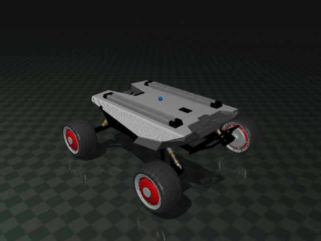

# SCOUT MINI for MuJoCo

MuJoCo model of the four-wheel differential-drive SCOUT MINI using the chassis
and wheel meshes from [AgileX's Gazebo repository](https://github.com/agilexrobotics/ugv_gazebo_sim/tree/master/scout).
Converted meshes are included locally; running requires no ROS, Gazebo, or downloads
beyond the Python dependencies.



```text
scout_mini/
  model/scout_mini.xml  # default Gazebo mesh model, ground, actuators, sensors
  model/scout_mini_primitive.xml # original lightweight model
  model/meshes/        # converted chassis and wheel meshes with color groups
  model/upstream/      # source descriptions, BSD notice, revision, checksums
  python/run.py        # automatic macOS / Windows / Linux launcher
  python/simulation.py # simple velocity command and viewer
  python/convert_gazebo.py # optional mesh conversion and MJCF generator
  requirements.txt
```

From this repository's root (Python 3.9+), create and activate an environment.

**macOS / Linux:**

```bash
python3 -m venv .venv
source .venv/bin/activate
```

**Windows (PowerShell):**

```powershell
python -m venv .venv
.\.venv\Scripts\Activate.ps1
```

Then install and run with the same commands on either platform:

```bash
python -m pip install -r scout_mini/requirements.txt
python scout_mini/python/run.py
```

The launcher selects `mjpython` on macOS and `python` on Windows/Linux, and passes
all command-line arguments to `simulation.py`. Headless mode uses the current
Python interpreter on every platform.

Drive in an arc, spin in place, or run without a window:

```bash
python scout_mini/python/run.py --linear 0.4 --angular 0.3 --duration 30
python scout_mini/python/run.py --linear 0 --angular 0.8
python scout_mini/python/run.py --headless --duration 5
python scout_mini/python/run.py --model primitive
```

Close the window to finish early. The robot settles for 0.5 simulated seconds
before driving; the duration includes that settling time. The model path resolves relative to the
script, so the launcher also works from other directories.

Coordinates are +X forward, +Y left, +Z up. Each actuator accepts a wheel velocity
in rad/s. Left and right commands use `(v - yaw_rate * track / 2) / radius` and
`(v + yaw_rate * track / 2) / radius`. Commands are scaled together if either side
exceeds the selected model's actuator limit. Positive yaw turns left; skid steering requires tire slip, so
actual yaw rate will differ from the ideal command. IMU, orientation, and four
wheel-speed sensors are available in the XML.

The default model uses the chassis/wheel subset of `mini.xacro`, which the
upstream `scout_mini_stock.launch` loads. This file differs from the repository's
other `scout_mini.xacro` and pre-generated URDF. The conversion retains its
463.951 mm wheelbase, 416.503 mm wheel-joint track, 80 mm collision-tire radius,
84 mm tire width, wheel poses, chassis collision box, and link inertias. The
collision cylinders sit 30 mm outward from the joints, so velocity mixing uses
a 476.503 mm contact track. The 10 kg chassis and four 3 kg wheels total 22 kg.
The example sensor/payload box is excluded. The rounded upstream ±1.57 rad
rotations are replaced by exact ±π/2 to align the axles.

The Collada scene transforms and diffuse colors are preserved in ten binary STL
mesh groups and MJCF materials. Meshes provide visuals; the upstream box/cylinder
collision shapes provide contact geometry. Wheel mounts are rigid as in the
source; visible springs in the chassis mesh do not articulate. Gazebo ROS plugins
are replaced by MuJoCo velocity actuators; the local IMU and wheel-speed sensors
remain available. The 18.75 rad/s limit corresponds to 1.5 m/s at the collision
tire radius; 8 Nm torque limits, servo gain, and friction are tuning assumptions.

The optional primitive model retains the earlier 23 kg mass, nominal
612 × 580 × 245 mm envelope, estimated 100 mm tire radius, 412 mm wheelbase,
490 mm track, and approximate vertical spring-damper suspension. Its dimensions
are based on the [current product specification](https://global.agilex.ai/products/scout-mini-off-road-robotics-research)
and geometric estimates. It is a separate approximation, not the imported variant.

This is an approximate simulation model, not a hardware-calibrated digital twin.
For predictive off-road use, replace estimates with measurements, calibrate tire
slip, motor response and suspension, and add the terrain and payload of interest.

Both models were validated with MuJoCo 3.2.7: XML loading, total mass, resting
stability, forward/reverse driving, turns in both directions, arc driving, and
command saturation without simulation warnings. The converted model was rendered
and visually inspected for mesh orientation and alignment. The interactive viewer
and execution on Windows were not tested directly; platform selection was checked
using mocked operating-system values.

To regenerate from a local checkout (conversion dependencies are optional):

```bash
git clone https://github.com/agilexrobotics/ugv_gazebo_sim.git
python -m pip install -r scout_mini/requirements-conversion.txt
python scout_mini/python/convert_gazebo.py /path/to/ugv_gazebo_sim
```

The generator writes `model/scout_mini.xml`, converted mesh assets, and provenance.
It uses the primitive model as a template for the ground, contacts, and sensors.
The included conversion comes from commit
`27633a956c845903ee630538afeb17fe70afdd84`. Original Xacro/package files, mesh-source
SHA-256 checksums, conversion notes, and the BSD notice are in `model/upstream/`.
